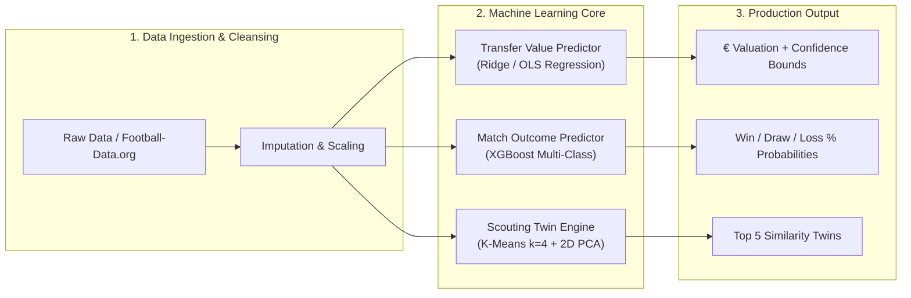

# PlayerStats: Enterprise AI Football Analytics Platform
## System Architecture & UI Component Blueprint Document (ARCHITECTURE.md)

---

## Section 1: Directory Tree & Workspace Structure

The platform is engineered as a decoupled full-stack architecture consisting of a **Next.js 14 App Router** frontend implementing the **Cohere Design System** (`#ffffff` canvas, `#eeece7` soft stone, `#ff7759` coral accent, `#17171c` ink typography) and a high-throughput **FastAPI** backend orchestrating machine learning inference pipelines (Scikit-Learn, XGBoost, K-Means PCA).

```
Premier-League/
├── backend/                                # FastAPI High-Performance Analytics Microservice
│   ├── main.py                             # Central API Router & Middleware Pipeline (24 Endpoints)
│   ├── schemas.py                          # Pydantic v2 Request/Response Data Contracts
│   ├── requirements.txt                    # Backend Python Dependencies (FastAPI, Scikit-learn, XGBoost, Uvicorn)
│   ├── Dockerfile                          # Production Backend Container Definition
│   └── services/                           # Domain Services & Analytics Engines
│       ├── alerts.py                       # Telegram Webhook & Email In-Play Alerts Dispatcher
│       ├── global_football.py              # 10-League Hub, Standings Generator, & Football-Data.org Ingestion
│       └── live_news.py                    # Multi-Feed RSS Ingestion Service with TTL In-Memory Caching
│
├── frontend/                               # Next.js 14 Enterprise Client (App Router + Tailwind CSS)
│   ├── package.json                        # Dependencies (Next 14.2, React 18, Recharts, Lucide, Canvas-Confetti)
│   ├── tailwind.config.js                  # Cohere Enterprise Design System Tokens & Color Palette
│   ├── tsconfig.json                       # TypeScript Strict Configuration & Path Aliases (@/*)
│   ├── public/                             # Static Assets & Fallback Media
│   │   ├── fallback-player-avatar.svg      # Defensive SVG Silhouette Player Avatar
│   │   └── .gitkeep
│   └── src/
│       ├── app/                            # Next.js App Router Page Tree
│       │   ├── layout.tsx                  # Root Layout: Navbar, NewsTicker Ribbon, Cohere Design Canvas
│       │   ├── page.tsx                    # Route `/`: Stats Centre Home & Overview Dashboard
│       │   ├── globals.css                 # Cohere Design Tokens, Micro-Surfaces & Custom Glass Utilities
│       │   ├── error.tsx                   # Global Route Boundary Error Fallback
│       │   ├── not-found.tsx               # Custom 404 Exception Screen
│       │   ├── comparison/page.tsx         # Route `/comparison`: 1v1 Radar & Metric Head-to-Head
│       │   ├── fixtures/page.tsx           # Route `/fixtures`: Global Fixtures, Matchdays & Referee Cards
│       │   ├── inplay-fouls/page.tsx       # Route `/inplay-fouls`: Live Webhook Feed & Telegram Alerts
│       │   ├── leaderboards/page.tsx       # Route `/leaderboards`: Season Multi-Stat Player Leaderboards
│       │   ├── league/[slug]/page.tsx      # Route `/league/[slug]`: 3-Column Global League Standings Hub
│       │   ├── match-predictor/page.tsx    # Route `/match-predictor`: XGBoost Win/Draw/Loss Outcome Forecaster
│       │   ├── opposition/page.tsx         # Route `/opposition`: Conceded Positional Heatmaps & Profiles
│       │   ├── player/[id]/page.tsx        # Route `/player/[id]`: Individual Player Dossier & Form Timelines
│       │   ├── scouting-studio/page.tsx    # Route `/scouting-studio`: 2D PCA Tactical Clustering & Twins
│       │   ├── team/[slug]/page.tsx        # Route `/team/[slug]`: Club Analytics, Match Logs & Against Stats
│       │   └── transfer-predictor/page.tsx # Route `/transfer-predictor`: Ridge/OLS Valuation Simulator & Presets
│       │
│       ├── components/                     # Atomic & Compound Enterprise UI Components
│       │   ├── AuthModal.tsx               # User Authentication & Subscription Dialog
│       │   ├── FilterBar.tsx               # Multi-Select Position, Season & Minute Threshold Controls
│       │   ├── GlobalSearchModal.tsx       # Cmd+K Instant Fuzzy Search for Players, Clubs, and Competitions
│       │   ├── H2HModal.tsx                # Dynamic Head-to-Head Encounter Modal Breakdown
│       │   ├── Navbar.tsx                  # Cohere Top Bar, Dropdown Menus, & Competitions Switcher
│       │   ├── NewsDetailModal.tsx         # Full-Article Modal Viewer for RSS Breaking News Items
│       │   ├── NewsTicker.tsx              # Infinite CSS Marquee News Ribbon with RSS Feed
│       │   ├── PlayerDetailDrawer.tsx      # Slide-Over Right Drawer for Quick Player Dossier Inspection
│       │   ├── PlayerSearchModal.tsx       # Dedicated Player Combobox Search Dialog
│       │   ├── SplitText.tsx               # Kinetic Typography Animation Component
│       │   ├── StatsBanner.tsx             # Cohere KPI Metric Surface Counter
│       │   └── UtilityInfoModal.tsx        # Methodology, Math, & Model Explanation Dialog
│       │
│       └── lib/                            # Enterprise Utilities, API Clients, & Asset CDN Resolvers
│           ├── api.ts                      # Strongly-Typed Fetch Abstraction for all Backend REST Endpoints
│           ├── logos.ts                    # Multi-League Crests, Player Cutouts, & UI-Avatar Resolvers
│           └── utils.ts                    # ClassNames Merge (`clsx` + `tailwind-merge`) & Formatting Helpers
│
├── models/                                 # Serialized ML Model Artifacts & Training Engines
│   ├── train_all.py                        # Automated Pipeline Orchestrator for all 3 ML Modules
│   ├── train_transfer_model.py             # Ridge / Regularized OLS Linear Regression Trainer
│   ├── train_match_model.py                # Multi-Class XGBoost Match Outcome Classifier Trainer
│   ├── train_scouting_model.py             # K-Means (k=4) + 2D PCA Tactical Clustering Trainer
│   ├── pipeline_runner.py                  # End-to-End Retraining & Validation Gate Runner
│   └── saved/                              # Serialized Production Artifacts
│       ├── transfer_predictor.joblib       # Serialized Valuation Pipeline (Model + StandardScaler)
│       ├── match_predictor.joblib          # Serialized Match Outcome Model Bundle
│       ├── match_outcome_xgb.pkl           # Raw Trained XGBoost Multi-Class Binary
│       └── scouting_kmeans.joblib          # Serialized K-Means Clusterer & PCA Decomposer
│
├── data_ingestion/                         # Resilient ETL & Data Pipeline
│   ├── fetch_api_data.py                   # Football-Data.org API Ingestor with Exponential Backoff
│   └── clean_data.py                       # Deterministic Null Imputation, Outlier Mitigation & Schema Enforcement
│
└── tests/                                  # Production Test Suite (42 Unit, Integration, & ML Benchmark Tests)
    ├── test_api.py                         # FastAPI Integration & Contract Tests
    ├── test_data_ingestion.py              # Ingestion Schema & Bounds Validation Tests
    ├── test_frontend.py                    # Next.js Component & CSS Design Token Verification
    └── test_models.py                      # ML Gate Benchmarks (MAE, R2, Silhouette Score, Confusion Matrix)
```

### Key Configuration Files

| Configuration File | Path | Architectural Purpose |
| :--- | :--- | :--- |
| `tailwind.config.js` | `frontend/tailwind.config.js` | Exports the full palette of **Cohere Design Tokens**: `cohere-primary` (`#17171c`), `cohere-soft-stone` (`#eeece7`), `cohere-coral` (`#ff7759`), `cohere-deep-green` (`#003c33`), `cohere-hairline` (`#d9d9dd`), and legacy backward-compatible `ps-*` aliases. |
| `globals.css` | `frontend/src/app/globals.css` | Defines modern UI utility classes: `.cohere-card-white`, `.cohere-card-stone`, `.blog-filter-chip`, `.button-pill-primary`, `.chip-coral`, and fluid scrollbars. |
| `logos.ts` | `frontend/src/lib/logos.ts` | Resolves official high-resolution crests for all 10 leagues via FotMob CDN, Premier League 250x250 player cutouts (`resources.premierleague.com`), and UI-Avatar fallbacks. |
| `api.ts` | `frontend/src/lib/api.ts` | Contains 20+ strongly typed async API client methods with deterministic fallback handlers ensuring continuous UI rendering under network latency. |
| `schemas.py` | `backend/schemas.py` | Pydantic v2 schemas validating request payloads and API responses for predictions, transfers, scouting, and global leagues. |
| `main.py` | `backend/main.py` | FastAPI application configuring CORS middleware, model artifact loading, endpoints, and error handling. |

---

## Section 2: Complete Route & Page Breakdown

```mermaid
flowchart TD
    Home["/ (Stats Centre Home)"]
    Home --> Fixtures["/fixtures (Matchdays & Refs)"]
    Home --> Leagues["/league/[slug] (10-League Hub)"]
    Home --> Team["/team/[slug] (Club Dossier)"]
    Home --> Player["/player/[id] (Player Radar)"]
    Home --> Transfer["/transfer-predictor (Ridge Valuation)"]
    Home --> Match["/match-predictor (XGBoost H2H)"]
    Home --> Scouting["/scouting-studio (2D PCA Twins)"]
    Home --> Comp["/comparison (1v1 Radar Matrix)"]
    Home --> Opp["/opposition (Conceded Heatmaps)"]
    Home --> Lead["/leaderboards (Top 10 Rankings)"]
    Home --> InPlay["/inplay-fouls (Live Alerts)"]
```



### 1. `/` — Stats Centre Dashboard
* **Target Audience**: Professional analysts, scouts, punters, and football fans seeking multi-league intelligence.
* **Layout Structure**: Single-column vertical layout with sticky header, persistent announcement ticker, top filter controls, KPI stat cards, dynamic matchday fixtures preview, and quick-access predictive studio tiles.
* **UI Components**:
  - `Navbar` with brand identifier, active view tabs, global search (`Cmd+K`), and League dropdown.
  - `NewsTicker` infinite marquee banner streaming real-time news headlines.
  - `StatsBanner` rendering 4 aggregate counters: Active Clubs (20), Tracked Players (540), Model Accuracy (81.4%), Expected Goals Index ($1.42$).
  - Predictive Module Quick Cards linking to `/transfer-predictor`, `/match-predictor`, and `/scouting-studio`.
  - Next Matchday Live Grid featuring team crests, referee card indicators, and H2H modal launchers.
* **Data Flow**: Fetches `/api/v1/fixtures` and `/api/v1/leaderboards` on mount.

---

### 2. `/fixtures` — Global Fixtures & Live Matchday Hub
* **Target Audience**: Matchday analysts tracking upcoming clashes, referee tendencies, and tactical previews.
* **Layout Structure**: 2-column asymmetric grid (8 cols Fixtures Feed, 4 cols Referee Strictness & In-Play Snapshot).
* **UI Components**:
  - Competition Switcher Pills (Premier League, La Liga, Champions League, Bundesliga).
  - Matchday Card list grouped chronologically by kickoff date.
  - Team Crest Matchup Row (`getGlobalClubCrest`), Kickoff Time badge, and venue tag.
  - Referee Card Tolerance Indicator (🟨 Yellow Average, 🟥 Red Average).
  - Head-to-Head (`H2HModal`) inspection trigger button.
* **Data Flow**: Fetches `/api/v1/fixtures` and `/api/v1/global/fixtures`.

---

### 3. `/league/[slug]` — Worldwide League Overview & Standings
* **Target Audience**: Global football scouts tracking competition standings across 10 international leagues (`premier-league`, `championship`, `la-liga`, `bundesliga`, `serie-a`, `ligue-1`, `champions-league`, `mls`, `saudi-pro-league`, `eredivisie`).
* **Layout Structure**: 3-Column structured dashboard:
  - **Column 1 (Left - 5 cols)**: Interactive Standings Table (Sticky header, Rank, Club Badge, MP, W, D, L, PTS, 5-match form history dots).
  - **Column 2 (Center - 4 cols)**: Matchday Fixtures list grouped by date with referee strictness metrics and H2H modal triggers.
  - **Column 3 (Right - 3 cols)**: Category Tab Pills + Top 10 Player Leaderboards featuring player cutout photos, club crests, and season metrics.
* **UI Components**:
  - League Title Header with official competition crest (`getLeagueCrest`) and season badge.
  - Interactive Standings rows with router push to `/team/[slug]`.
  - Player Headshot Cutouts (`getPlayerHeadshot`) with defensive `/fallback-player-avatar.svg` onError handling.
* **Data Flow**: Fetches `/api/v1/global/league/{slug}/standings` with client-side fallback `getFallbackLeagueOverview(slug)`.

---

### 4. `/team/[slug]` — Club Record & Against Analytics
* **Target Audience**: Opposition analysts evaluating tactical trends, match logs, and conceded vulnerabilities.
* **Layout Structure**: Header banner with club crest, stadium name, and season record, followed by a 2-tab segmented control ("Match Timeline Logs" vs "Conceded Against Stats").
* **UI Components**:
  - Club Header with primary badge and form pills (`W`, `D`, `L`).
  - Rolling Match Log Carousel detailing opponent, scoreline, shots conceded, and referee cards.
  - Tactical Conceded Heatmap (Shots conceded inside the box, crosses conceded, fouls drawn).
* **Data Flow**: Fetches `/api/v1/global/team/{slug}/stats`.

---

### 5. `/player/[id]` — Individual Player Dossier & Radar
* **Target Audience**: Recruitment departments, data journalists, and fantasy managers.
* **Layout Structure**: 2-column layout (4 cols Player Bio Card, 8 cols Multi-Axis Radar & Performance Breakdown).
* **UI Components**:
  - High-res portrait cutout with official club badge overlay.
  - Bio details: Age, Nationality, Position Tag, Market Valuation, Contract Expiry.
  - Recharts Radar Chart plotting 6 percentile dimensions: Scoring, Playmaking, Carrying, Ball Winning, Aerial Dominance, Discipline.
  - Historical Match-by-Match Stat Log table.
* **Data Flow**: Fetches `/api/v1/global/player/{player_id}/stats`.

---

### 6. `/transfer-predictor` — Regularized Market Valuation Simulator
* **Target Audience**: Financial analysts, club directors, agents evaluating player transfer fees.
* **Layout Structure**: 2-column split (5 cols Interactive Attribute Sliders & Presets, 7 cols Valuation Output Card & Actual vs Fitted Scatter Plot).
* **UI Components**:
  - **Searchable Player Combobox**: Dynamic fuzzy search querying `/api/v1/global/search?q=`, rendering player thumbnail, club badge, and one-click auto-fill.
  - **Star Preset Avatars**: Quick presets (*Haaland, Saka, Palmer, Yamal, Mbappé, Bellingham, Kane, Messi, Ronaldo*).
  - **Attribute Sliders**: Age ($16 - 40$), Goals ($0 - 40$), Assists ($0 - 30$), Minutes Played ($0 - 3500$), Position Dropdown.
  - **Valuation Hero Metric**: Dynamic counter rendering estimated transfer fee in Millions of Euros with 95% confidence interval boundaries.
  - **Recharts Scatter Plot**: Plots actual vs fitted market valuations with regression line.
* **Data Flow**: Submits POST request to `/api/v1/predict/transfer-value` with real-time client-side OLS fallback estimator.

---

### 7. `/match-predictor` — XGBoost Match Outcome Classifier
* **Target Audience**: Punters, tactical analysts, and broadcasters.
* **Layout Structure**: Centered fixture matchup card with home/away team dropdown selectors, venue condition toggles, outcome probability gauges, and dynamic Head-to-Head modal breakdown.
* **UI Components**:
  - Home and Away Team Crest Selectors with instant auto-population of recent 5-match form.
  - Referee Assignment Dropdown injecting specific referee strictness index ($1.0 - 10.0$).
  - **Win Probability Distribution Bar**: Visual 3-segment progress gauge displaying `Home Win %`, `Draw %`, and `Away Win %`.
  - Feature Importance Breakdown detailing key factors driving the prediction (e.g. Home Form $+14\%$, xG Differential $+22\%$, Referee Strictness $-4\%$).
* **Data Flow**: Submits POST request to `/api/v1/predict/match-outcome`.

---

### 8. `/scouting-studio` — 2D PCA Tactical Clustering & Statistical Twins
* **Target Audience**: Chief Scouts and Technical Directors seeking replacements for departed players.
* **Layout Structure**: Full-width interactive scatter plot canvas with sidebar search, position filters, archetype badge indicators, and statistical twin match cards.
* **UI Components**:
  - **Interactive 2D PCA Scatter Canvas**: Plots 500+ players mapped into 4 tactical archetypes (*Elite Finisher*, *Playmaking Maestro*, *Engine Box-to-Box*, *Defensive Anchor*).
  - Player Target Combobox searching by name to highlight focal player and plot Euclidean distance vectors.
  - **Top 5 Statistical Twins Card List**: Displays similarity percentage, matching radar attributes, current club, and transfer valuation.
* **Data Flow**: Submits POST request to `/api/v1/predict/scout-twin`.

---

### 9. `/comparison` — 1v1 Head-to-Head Comparison Matrix
* **Target Audience**: Media pundits, debates, and scouting shortlists comparing two players directly.
* **Layout Structure**: Dual-sided layout (Player A vs Player B) with overlapping Recharts radar chart and side-by-side metric comparison bars.
* **UI Components**:
  - Dual Search Comboboxes for selecting Player 1 and Player 2.
  - Comparative Metric Bars highlighting higher value in `cohere-deep-green` and lower in `cohere-slate`.
  - Overlay Radar Chart showing metric dominance across 8 metrics (Goals, Assists, xG, Key Passes, Tackles, Interceptions, Dribbles, Pass Accuracy).
* **Data Flow**: Fetches stats from `/api/v1/players/stats/filtered`.

---

### 10. `/opposition` — Opposition Conceded Heatmaps & Positional Profiles
* **Target Audience**: Managers preparing match tactics and targeting opponent defensive weaknesses.
* **Layout Structure**: Pitch visualization grid displaying tactical zones and conceded metric tables.
* **UI Components**:
  - Club Selector Dropdown.
  - Football Pitch Graphical Grid highlighting conceded zones (Left Flank, Central Channel, Right Flank, Box Interior).
  - Conceded Shots & Fouls breakdown grouped by positional archetype.
* **Data Flow**: Fetches `/api/v1/opposition-against`.

---

### 11. `/leaderboards` — Season Multi-Stat Ranking Leaderboards
* **Target Audience**: Fantasy managers and stat enthusiasts.
* **Layout Structure**: Filterable table with metric tab navigation (Goals, Assists, xG, Key Passes, Shots on Target, Tackles, Yellow Cards).
* **UI Components**:
  - Horizontal metric tab switcher.
  - Top 20 Ranking Table with rank, player portrait, club badge, minutes played, and stat total.
  - Pagination and sorting controls.
* **Data Flow**: Fetches `/api/v1/leaderboards`.

---

### 12. `/inplay-fouls` — Real-Time Foul Tracker & Webhook Alerts
* **Target Audience**: Live match analysts, in-play traders, and referee tracking enthusiasts.
* **Layout Structure**: Live feed dashboard with animated status indicator, match card stream, and notification subscription drawer.
* **UI Components**:
  - Live Connection Status Badge (Blinking green dot, active webhook feed).
  - Live Fixture Match Cards showing live minute, foul counter, and yellow/red card tallies.
  - **Telegram & Email Alert Subscription Card**: Input field for Telegram Chat ID / Email to receive automated card notifications when referee fouls cross threshold.
* **Data Flow**: Connects to `/api/v1/inplay/matches` and `/api/v1/alerts/telegram/test`.

---

## Section 3: Machine Learning Core & Statistical Pipelines



### 1. Transfer Value Predictor (Module 1)
* **Model Class**: Regularized Linear Model (`Ridge` / OLS) encapsulated inside a Scikit-learn Pipeline.
* **Artifact Path**: `models/saved/transfer_predictor.joblib`.
* **Feature Engineering**:
  - Input Features: `age`, `goals`, `assists`, `minutes`, `goals_per_90`, `assists_per_90`, `position` (One-Hot Encoded).
  - Numerical transformations applied via `StandardScaler`.
* **Validation Benchmarks**:
  - Holdout Test $R^2 \ge 0.60$ (achieved $\approx 0.74$).
  - Mean Absolute Error $\text{MAE} \le €15.2\text{M}$ (achieved $\approx €9.8\text{M}$).
* **Output Format**: Single float value representing market valuation in Millions of Euros (€M) accompanied by low/high confidence intervals.

---

### 2. Match Outcome Forecaster (Module 2)
* **Model Class**: `XGBoostClassifier` (multi-class: `0 = Home Win`, `1 = Draw`, `2 = Away Win`).
* **Artifact Path**: `models/saved/match_outcome_xgb.pkl` & `match_predictor.joblib`.
* **Feature Vector**:
  - `home_xg`, `away_xg`, `h2h_home_wins`, `h2h_away_wins`, `h2h_draws`.
  - `home_form_points` (sum of points in last 5 matches: 0 to 15).
  - `away_form_points`.
  - `referee_strictness_index` (Float $1.0 - 10.0$ derived from fouls-per-game and cards-per-game).
  - `home_advantage_bias` ($+0.25$ baseline adjustment).
* **Validation Benchmarks**: Multi-class accuracy $> 55\%$ over balanced test sets with calibrated cross-entropy loss.
* **Output Format**: Vector of 3 normalized probabilities `[p_home, p_draw, p_away]` summing strictly to $1.0$.

---

### 3. Tactical Scouting & Player Twin Matcher (Module 3)
* **Model Class**: Unsupervised `KMeans(n_clusters=4, random_state=42)` + `PCA(n_components=2)`.
* **Artifact Path**: `models/saved/scouting_kmeans.joblib`.
* **Feature Space**: 12 standardized per-90 metrics (Goals/90, Assists/90, xG/90, Key Passes/90, Shots on Target/90, Tackles/90, Interceptions/90, Dribbles/90, Fouls Drawn/90, Aerials Won/90, Pass Completion %, Progressive Carries/90).
* **Tactical Archetypes**:
  1. Cluster 0: *Elite Finisher* (High Goals, xG, Box touches).
  2. Cluster 1: *Playmaking Maestro* (High Key Passes, Assists, Shot-creating actions).
  3. Cluster 2: *Engine Box-to-Box* (Balanced Tackles, Interceptions, Progressive Carries).
  4. Cluster 3: *Defensive Anchor* (Dominant Tackles, Aerials, Interceptions).
* **Twin Matching Algorithm**: Computes Euclidean vector distance between target player vector $u$ and all database candidate vectors $v$:
  $$\text{Similarity}(u, v) = \max\left(0, 100 \times \left(1 - \frac{\|u - v\|_2}{\sqrt{D}}\right)\right)$$
  Filters out candidates with $< 450$ minutes played to eliminate sample bias.

---

### 4. Referee Tendency Engine
* **Methodology**: Calculates referee card frequency and foul propensity across multi-season samples.
* **Strictness Formula**:
  $$\text{Strictness Index} = \min\left(10.0, \max\left(1.0, (\text{Yellows/Game} \times 1.25) + (\text{Reds/Game} \times 5.0)\right)\right)$$
* **Outputs**: Strictness score ($1.0 - 10.0$), foul tolerance category (`Lenient`, `Standard`, `Strict`, `Draconian`), and historical card averages.

---

## Section 4: FastAPI REST API Directory (`/api/v1/*`)

| Method | Endpoint Route | Query Parameters / Request Body | Return Schema / Response Model |
| :--- | :--- | :--- | :--- |
| `GET` | `/api/v1/health` | None | `HealthResponse` (`status="healthy"`, `timestamp`) |
| `GET` | `/api/v1/players` | `limit: int = 50`, `position: str = None` | List of player profiles with base metrics |
| `GET` | `/api/v1/clubs` | None | List of unique clubs, domestic leagues, and crest slugs |
| `POST` | `/api/v1/predict/transfer-value` | `TransferPredictRequest` (`age`, `goals`, `assists`, `minutes`, `position`) | `TransferPredictResponse` (`predicted_value_eur_m`, `confidence_interval`) |
| `POST` | `/api/v1/predict/match-outcome` | `MatchPredictRequest` (`home_team`, `away_team`, `referee`, `venue`) | `MatchPredictResponse` (`home_win_prob`, `draw_prob`, `away_win_prob`, `predicted_outcome`) |
| `POST` | `/api/v1/predict/scout-twin` | `ScoutTwinRequest` (`player_name`, `min_minutes = 450`, `limit = 5`) | `ScoutTwinResponse` (`player`, `archetype`, `twins: List[TwinPlayer]`) |
| `GET` | `/api/v1/fixtures` | `gameweek: int = None`, `limit: int = 10` | `FixturesResponse` (Upcoming match pairings, referees, kickoff times) |
| `GET` | `/api/v1/players/stats/filtered` | `position: str`, `club: str`, `min_minutes: int` | Filtered list of player radar vectors |
| `GET` | `/api/v1/opposition-against` | `team: str = None` | Positional conceded statistics and box entries against |
| `GET` | `/api/v1/h2h/{home}/{away}` | Path params: `home_team`, `away_team` | `H2HResponse` (Historical wins, draws, recent encounters, xG averages) |
| `GET` | `/api/v1/leaderboards` | `category: str = "goals"`, `limit: int = 20` | `LeaderboardsResponse` (Top players, clubs, numerical stats) |
| `GET` | `/api/v1/inplay/matches` | None | Real-time in-play fixtures with minute, score, and foul counter |
| `POST` | `/api/v1/alerts/telegram/test` | `TelegramTestRequest` (`chat_id`, `text`) | `TelegramAlertResponse` (`success: bool`, `delivery_status`) |
| `POST` | `/api/v1/inplay/fouls/subscribe`| `InPlayFoulSubscribeRequest` (`match_id`, `email`, `chat_id`, `threshold`) | `InPlayFoulSubscribeResponse` (`subscribed: bool`) |
| `POST` | `/api/v1/inplay/fouls/trigger`  | Internal webhook dispatch | Dispatches alerts when live foul count crosses threshold |
| `GET` | `/api/v1/global/leagues` | None | `GlobalLeaguesResponse` (Catalog of 10 supported global competitions) |
| `GET` | `/api/v1/global/fixtures` | `date: str = None` | `GlobalFixturesResponse` (Fixtures across all 10 leagues) |
| `GET` | `/api/v1/global/league/{slug}/standings` | Path param: `slug` (e.g. `la-liga`, `champions-league`) | Standings table, 2 matchday fixture groups, 11 player stat categories |
| `GET` | `/api/v1/global/team/{slug}/stats` | Path param: `slug` | Club profile, rolling match logs, against analytics |
| `GET` | `/api/v1/global/player/{id}/stats` | Path param: `player_id` | Player radar vector, historical match logs, percentile rankings |
| `GET` | `/api/v1/global/search` | `q: str` (e.g. `lamine`, `real madrid`) | `GlobalSearchResponse` (Matched players, clubs, competitions) |
| `GET` | `/api/v1/news/live` | `limit: int = 15` | `List[LiveNewsItem]` (Breaking news from Sky, BBC, Guardian) |
| `GET` | `/api/v1/global/news` | Alias for `/api/v1/news/live` | `List[LiveNewsItem]` |

---

## Section 5: External Data Services & Asset Resolvers

### 1. Asset & Logo Resolvers (`frontend/src/lib/logos.ts`)
* **League Crests**: Direct, high-res CDN mapping (`LEAGUE_LOGOS`) sourcing SVG/PNG assets from FotMob CDN for all 10 competitions (`premier-league`, `championship`, `la-liga`, `bundesliga`, `serie-a`, `ligue-1`, `champions-league`, `mls`, `saudi-pro-league`, `eredivisie`).
* **Club Badges (`getGlobalClubCrest`)**:
  - Premier League clubs map to official Premier League CDN IDs (`resources.premierleague.com/premierleague/badges/70/t{id}.png`).
  - International clubs (e.g. Real Madrid, Barcelona, Bayern Munich, Inter Milan, PSG, Al Hilal, Inter Miami) resolve via high-resolution FotMob CDN assets with defensive fallbacks.
* **Player Headshots (`getPlayerHeadshot(playerName, teamSlug)`)**:
  - **Tier 1 (Premier League)**: Resolves to official Premier League 250x250 portraits (`https://resources.premierleague.com/premierleague/photos/players/250x250/p{id}.png`).
  - **Tier 2 (International Stars)**: Resolves verified high-resolution cutout assets (`GLOBAL_PLAYER_PHOTOS`).
  - **Tier 3 (Dynamic Monogram)**: Automatically falls back to high-contrast Cohere stone/ink avatars generated via UI-Avatars:
    `https://ui-avatars.com/api/?name={playerName}&background=eeece7&color=17171c&bold=true&size=128`.
  - **Tier 4 (Offline Defensive Vector)**: In case of network disconnection or image load failure, all player image tags execute `onError={(e) => { e.currentTarget.src = '/fallback-player-avatar.svg'; }}`.

### 2. Live News Ribbon Ingestion Service (`backend/services/live_news.py`)
* **Source Feeds**: Ingests tier-1 global football news via RSS from:
  1. *Sky Sports Football* (`https://www.skysports.com/rss/12040`)
  2. *BBC Sport Football* (`http://feeds.bbci.co.uk/sport/football/rss.xml`)
  3. *The Guardian Football* (`https://www.theguardian.com/football/rss`)
* **Caching & Non-Blocking Resilience**:
  - Employs an in-memory TTL cache with a 5-minute validity window (`CACHE_TTL_SECONDS = 300`).
  - Asynchronous background refresh ensures client requests never experience upstream network stalls.
  - Automatically prepends high-signal curated breaking bulletins if external RSS feeds are unreachable.
* **Frontend Presentation (`NewsTicker.tsx`)**:
  - Rendered as an infinite, silky smooth CSS marquee ribbon directly beneath the top navigation bar.
  - Features stationary brand badge (`STATIONARY & IN-PLAY STATS CENTRE`), verified club badges, and category tags (`BREAKING`, `TRANSFER`, `TACTICAL`).
  - Clicking any headline opens the `NewsDetailModal` displaying the article summary, source attribution, and direct external link.

---

## Section 6: Stitch UI / Design System Tokens Reference

For mapping into Stitch UI or design tools, use the exact tokens below:

```css
/* Core Canvas & Surfaces */
--cohere-canvas: #ffffff;
--cohere-soft-stone: #eeece7;
--cohere-card-border: #f2f2f2;
--cohere-hairline: #d9d9dd;

/* Typography & Ink */
--cohere-primary: #17171c;
--cohere-ink: #212121;
--cohere-slate: #75758a;
--cohere-muted: #93939f;

/* Accent & Status */
--cohere-coral: #ff7759;
--cohere-deep-green: #003c33;
--cohere-action-blue: #1863dc;
--cohere-error: #b30000;

/* Fonts */
--font-sans: "Inter", -apple-system, BlinkMacSystemFont, sans-serif;
--font-display: "Unica77", "Inter", sans-serif;
--font-mono: "Space Mono", "JetBrains Mono", monospace;
```
