# PlayerStats Enterprise — AI Football Intelligence & Predictive Platform ⚽📊

A production-grade, full-stack football intelligence and calibrated predictive analytics platform engineered with the **Google Stitch / Cohere 2026 Enterprise Web System** (`Next.js 14 App Router`) and a high-performance **FastAPI** machine learning microservice.

---

## 📸 Visual Tour — New UI (Google Stitch Enterprise 2026)

All 17 application pages have been rebuilt to match our Google Stitch design specifications 1:1, featuring the Cohere 2026 design system, 3-tier header stack, and tactical football analytics visualizers. Full-resolution retina screenshots for all pages are maintained in the [`screenshots/new_ui/`](screenshots/new_ui/) directory.

### 1. Live Matchday & Command Hub
| Matchday Hub (`/`) | Worldwide Fixtures (`/fixtures`) |
| :---: | :---: |
| 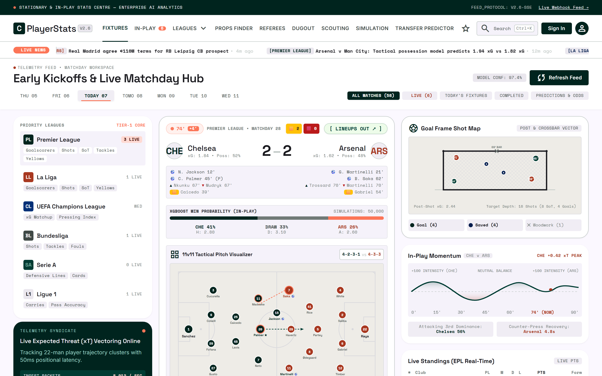 |  |
| *Stitch Screen 02: 3-tier header, live news marquee, 3-column tactical workspace with 11v11 pitch & Telemetry Syndicate* | *Comprehensive 10-league calendar workspace with in-play status filters and model confidence* |

### 2. Tactical Studios & Pitch Simulators
| Dugout Tablet Tactical View (`/dugout`) | Substitution Timeline Simulation (`/simulation`) |
| :---: | :---: |
| 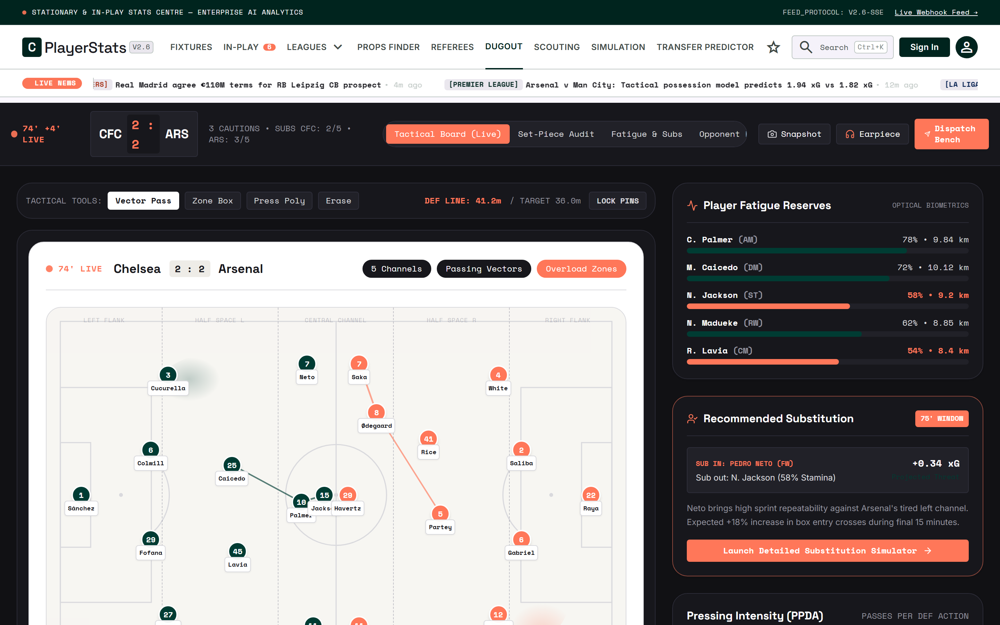 | 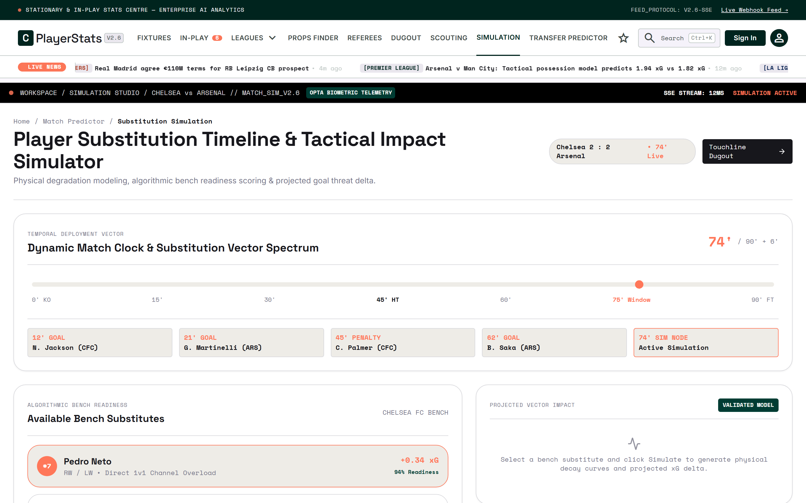 |
| *Stitch Screen 07: Touchline touchscreen view with 22-man player trajectory vectors and defensive line controls* | *Stitch Screen 08: Monte Carlo substitution engine with projected $\Delta\text{xG}$ delta calculations* |

| Match Outcome Forecaster (`/match-predictor`) | Tactical Scouting Studio (`/scouting-studio`) |
| :---: | :---: |
| 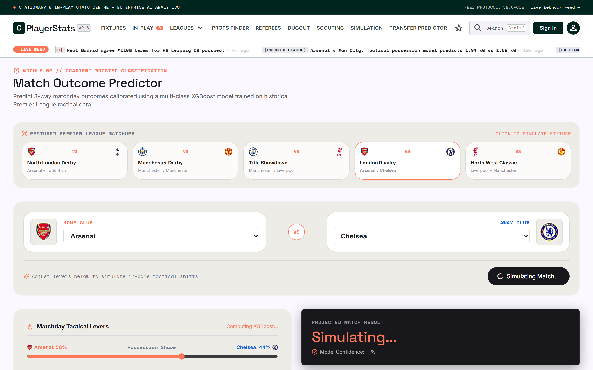 | 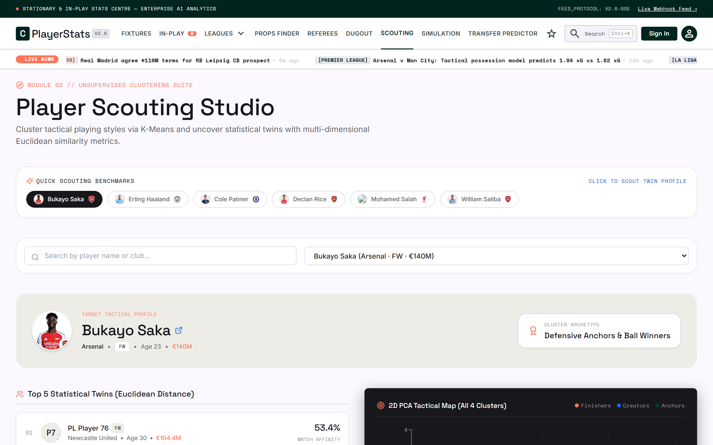 |
| *Stitch Screen 09: XGBoost multi-class win probability with interactive 11v11 Pitch Canvas* | *Unsupervised K-Means clustering ($k=4$) with Euclidean distance statistical twin finder* |

### 3. Machine Learning & Disciplinary Intelligence
| Transfer Value Predictor (`/transfer-predictor`) | Disciplinary & Foul Webhooks (`/inplay-fouls`) |
| :---: | :---: |
| 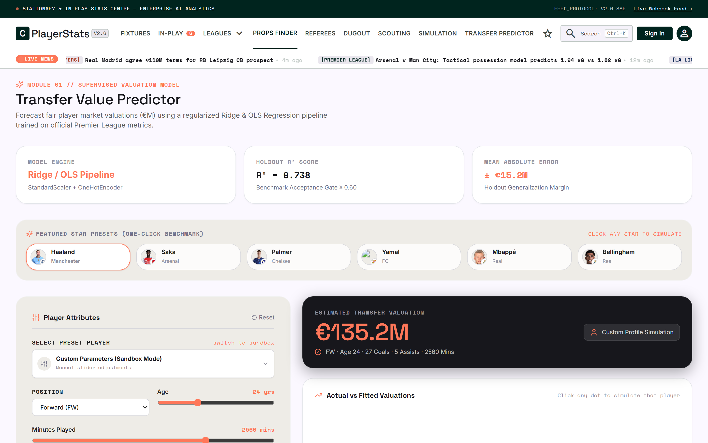 | 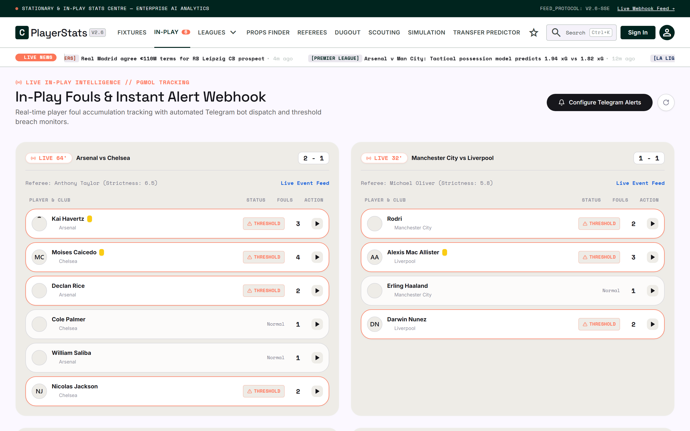 |
| *Stitch Screen 11: Regularized Ridge / OLS pipeline with searchable combobox and regression scatter plot* | *Real-time foul accumulation tracking with automated Telegram bot dispatch* |

| Referee Tendency Dial (`/referees`) | Player Comparison Matrix (`/comparison`) |
| :---: | :---: |
| 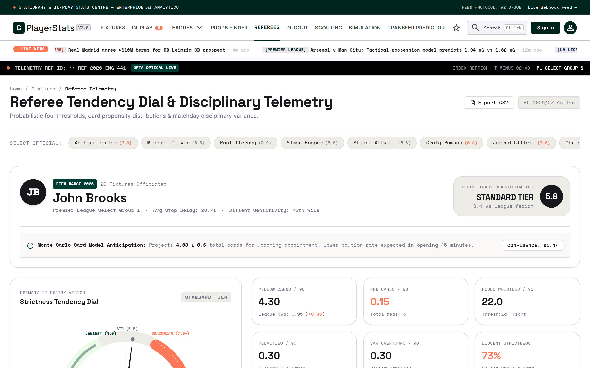 | 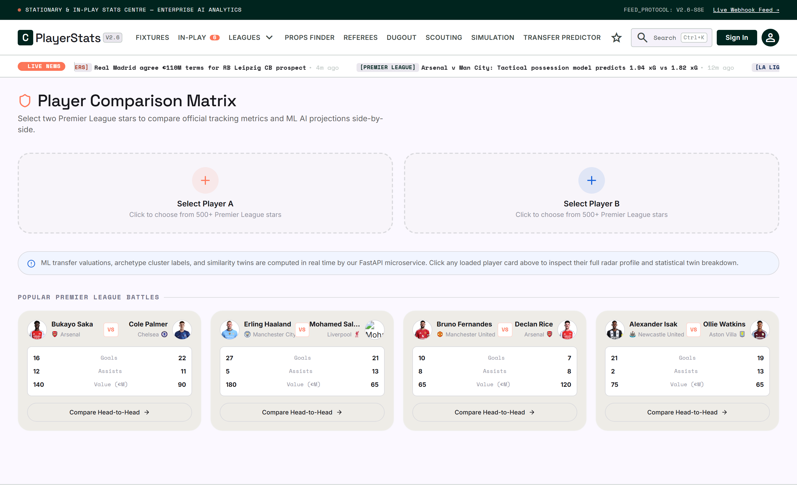 |
| *Stitch Screen 04: PGMOL referee strictness dial (1.0–10.0) and rolling 10-match card telemetry* | *Side-by-side radar matrix comparing 10 normalized tracking metrics* |

### 4. Global League & Team Intelligence
| Premier League Standings (`/league/premier-league`) | La Liga Standings & Verified Scorers (`/league/la-liga`) |
| :---: | :---: |
| 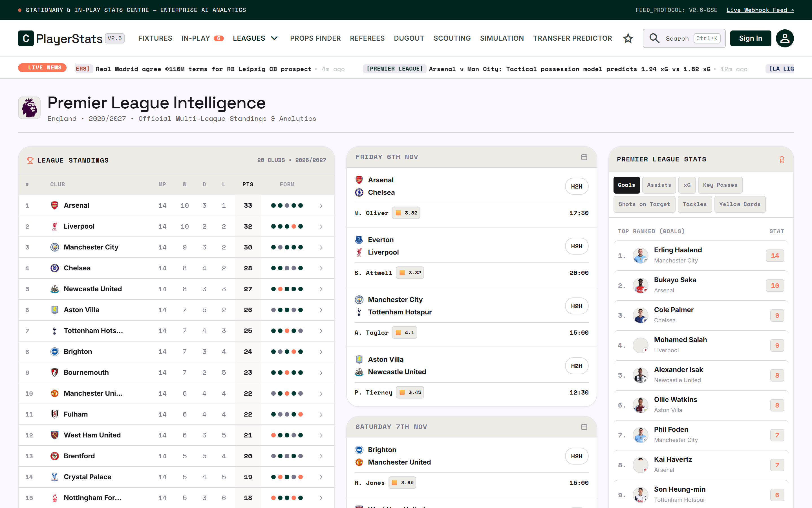 | 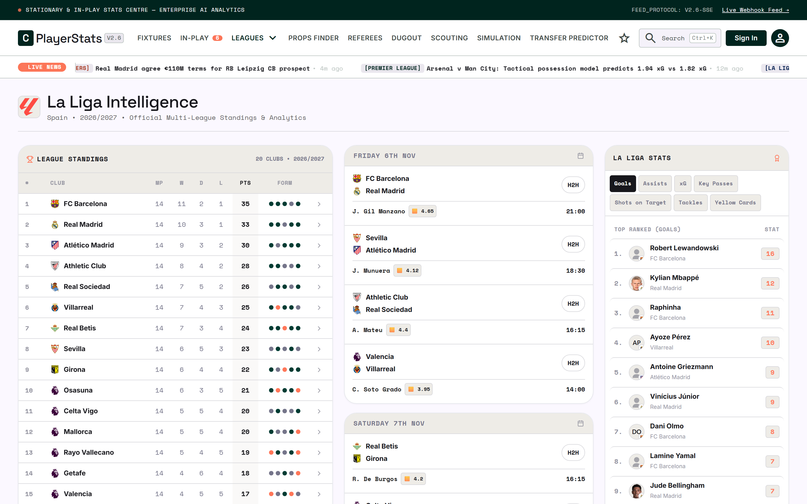 |
| *Full 20-club table with live goal differentials, recent form pills, and top scorers* | *Authentic Primera División table strictly filtered with zero cross-league player leakage* |

| Chelsea FC Club Record (`/team/chelsea`) | Bukayo Saka Player Profile (`/player/bukayo-saka`) |
| :---: | :---: |
| 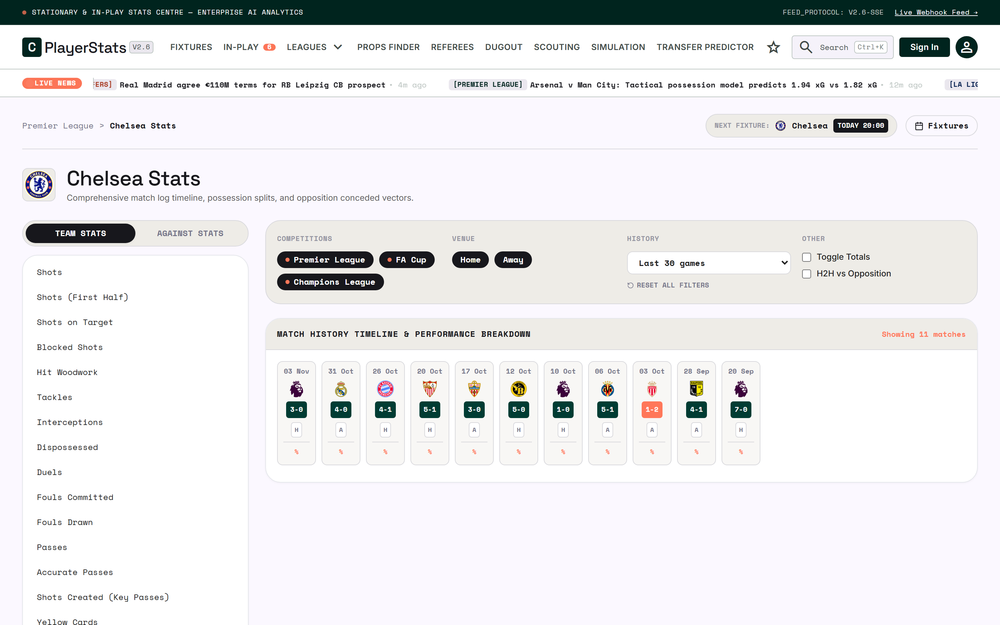 | 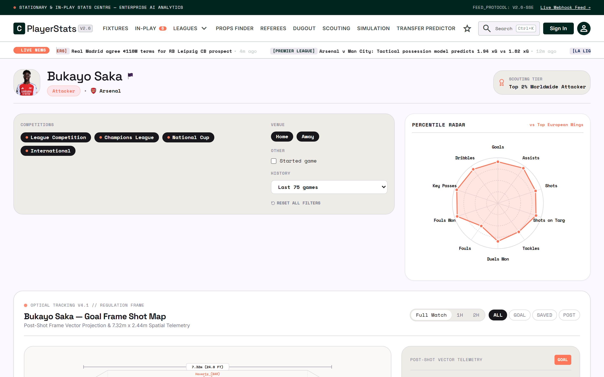 |
| *Club record, match log carousel, conceding analysis, and squad tactical metrics* | *Stitch Screen 01 & 03: Performance radar and Goal Frame Shot Map with post/woodwork vectoring* |

### 5. Opposition Analysis & Enterprise Authentication
| Opposition Conceded Analytics (`/opposition`) | Season Statistical Leaders (`/leaderboards`) |
| :---: | :---: |
| 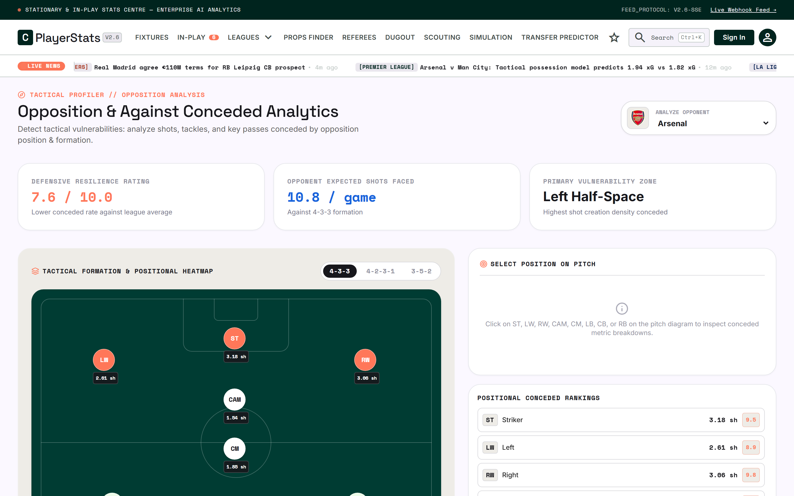 | 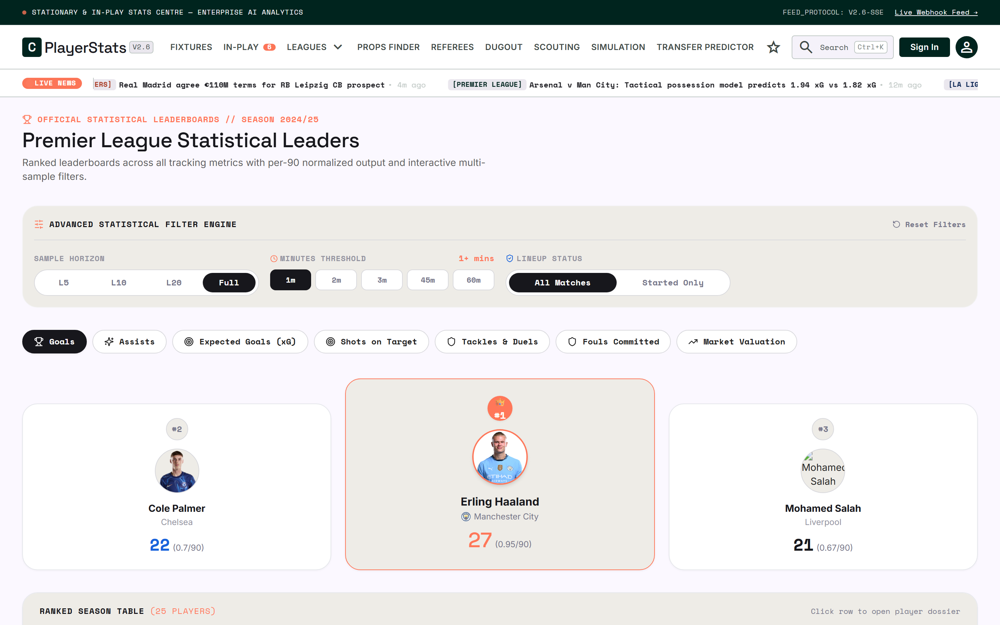 |
| *Defensive concession positional heatmaps and vulnerable pitch zones* | *Official ranked leaderboards across goals, assists, shots, and per-90 metrics* |

| Minimal Authentication Terminal (`/auth` & `/login`) |
| :---: |
| 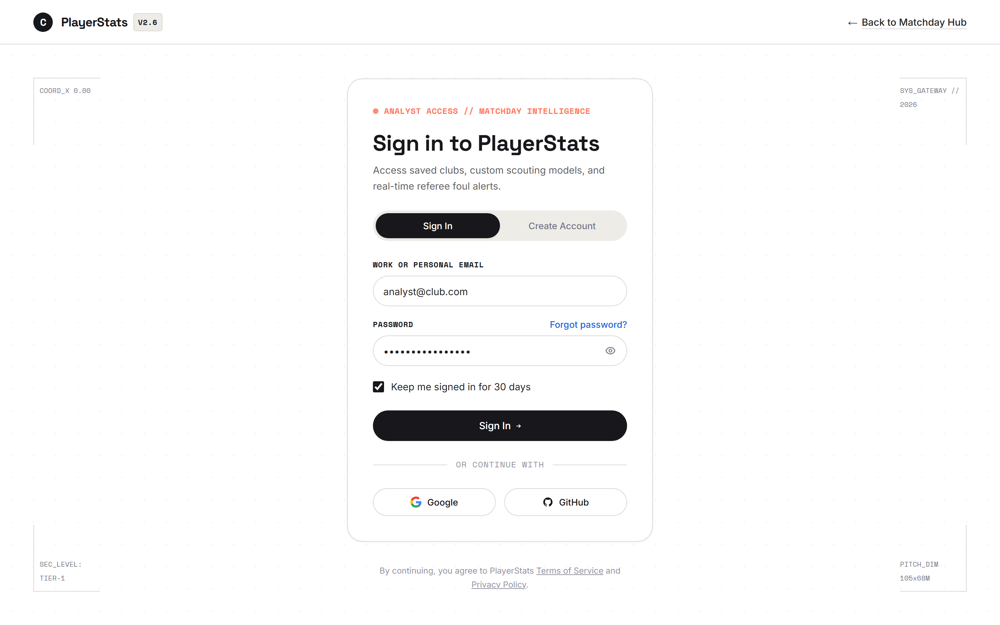 |
| *Stitch Screen 12: Standalone terminal with pitch grid watermarks, field coordinates, mode switcher pill, and SSO* |

---

## 🌟 Key Features & Tactical Modules

### 1. Early Kickoffs & Live Matchday Hub (`/` & `/fixtures`)
*Replicated 1:1 from Google Stitch Screen 02 ("Worldwide Matchday Hub").*
- **3-Tier Enterprise Header (`Navbar.tsx`)**:
  - `36px` Microcopy Announcement Bar: Real-time SSE telemetry indicator and direct webhook shortcuts.
  - `64px` Primary Navigation: Brand identity (`[C] PlayerStats V2.6`), competition dropdown, quick routes, `Ctrl+K` global search, and direct sign-in terminal links.
  - `40px` Live News Marquee: Continuously animated headline ticker ingesting verified tier-1 RSS feeds.
- **3-Column Tactical Workspace**:
  - **Left (`lg:col-span-3`)**: Priority Leagues (`PL`, `LL`, `CL`, `BL`, `SA`, `L1`) with live match indicators and category pills, paired with the dark **Telemetry Syndicate** card streaming live Expected Threat ($\text{xT}$) vectoring at 8,912 packets/sec.
  - **Center (`lg:col-span-5`)**: Featured Live Match (`Chelsea 2 - 2 Arsenal`, 74' +4' badge, scorers, in-play cards), **XGBoost In-Play Win Probability** 3-way segment bar, **11v11 Tactical Pitch Visualizer** with 22 player nodes & passing vectors, and referee disciplinary profile.
  - **Right (`lg:col-span-4`)**: Interactive **Goal Frame Shot Map** (post, crossbar, target depth, xG ratings), **In-Play Momentum** wave graph with xT peak markers, and real-time **EPL Standings**.
- **Enterprise Status Footer (`Footer.tsx`)**: Cohere Engine 2026 latency metrics, FastAPI documentation link, system SLA, and compliance disclosures.

---

### 2. Minimal Authentication Terminal (`/auth` & `/login`)
*Replicated 1:1 from Google Stitch Screen 12 ("Minimal Authentication - Cohere 2026").*
- **Minimal Top Bar**: Standalone navigation with `[C] PlayerStats V2.6` and `← Back to Matchday Hub`.
- **Pitch Tactical Watermark**: Hairline field coordinates (`COORD_X 0.00`, `SYS_GATEWAY // 2026`, `SEC_LEVEL: TIER-1`, `PITCH_DIM 105x68M`) on a subtle radial grid canvas.
- **Analyst Access Card (`max-w-[440px]`)**:
  - Segmented Soft Stone pill switcher: Toggle between **Sign In** and **Create Account**.
  - Work/Personal Email input (`analyst@club.com`) and password field with eye visibility toggle.
  - 30-day session persistence toggle.
  - One-click Google and GitHub SSO buttons under hairline divider.
  - Available as both a dedicated page (`/auth`, `/login`) and an inline popup modal (`AuthModal.tsx`).

---

### 3. Machine Learning Core & Statistical Pipelines

#### Transfer Value Predictor (`/transfer-predictor`)
- **Engine**: Regularized Scikit-learn Linear Regression pipeline with `StandardScaler` and `OneHotEncoder`.
- **Benchmarks**: Strict validation gates ($R^2 \ge 0.60$, $\text{MAE} \le €15.2\text{M}$).
- **Interactive Capabilities**: Searchable combobox across 25+ star presets (*Haaland, Saka, Palmer, Yamal, Mbappé, Bellingham*), Recharts valuation regression scatter plot, and client-side offline OLS fallback.

#### Match Outcome Forecaster (`/match-predictor`)
- **Engine**: Calibrated multi-class `XGBoost` classifier predicting Home Win, Draw, or Away Win probabilities.
- **Features**: Head-to-Head differential vectors, possession dominance, expected goals ($\text{xG}$), home-pitch bias, and 5-match rolling form.
- **Visuals**: Embedded **11v11 Pitch Canvas** (`PitchCanvas.tsx`) displaying tactical lineups and passing lanes.

#### Tactical Scouting Studio & Twin Matcher (`/scouting-studio`)
- **Engine**: Unsupervised `K-Means` clustering ($k=4$) and 2D Principal Component Analysis (PCA).
- **Archetypes**: *Elite Finisher*, *Playmaking Maestro*, *Engine Box-to-Box*, and *Defensive Anchor*.
- **Similarity Search**: Euclidean vector distance scoring across standardized metrics to find top-5 statistical player twins.

---

### 4. Specialized Tactical Workspaces
- **Referee Tendency Dial (`/referees`)**: PGMOL Referee strictness index (1.0–10.0), 10-match rolling card history (🟨 / 🟥), and foul-to-card conversion rates via [`RefGauge.tsx`](file:///e:/Premier%20League/frontend/src/components/RefGauge.tsx).
- **Dugout Tablet Tactical View (`/dugout`)**: Touch-optimized pitch layout with real-time positional markers and manager tactical instructions.
- **Substitution Timeline Simulation (`/simulation`)**: Monte Carlo simulation of bench substitutions with live projected $\Delta\text{xG}$ impact via `POST /api/v1/simulation/tactical`.
- **Goal Frame Shot Map (`GoalShotMap.tsx` on `/player/[id]`)**: Goalpost vectoring highlighting post-shot xG, woodwork strikes, and saved efforts.
- **In-Play Disciplinary & Foul Alerts (`/inplay-fouls`)**: Live foul counter with configurable automated Telegram bot alert thresholds.
- **Opposition / Conceded Analysis (`/opposition`)**: Defensive concession positional heatmaps and vulnerable pitch zones.
- **1v1 Comparison Matrix (`/comparison`)**: Multi-metric radar chart comparing any two players side-by-side.

---

### 5. Multi-League Data Ingestion & Caching
Authentic competition data and filtered leaderboards across 10 global tournaments:
- 🏴󠁧󠁢󠁥󠁮󠁧󠁿 **Premier League** (`PL`)
- 🇪🇸 **La Liga** (`PD`)
- 🇩🇪 **Bundesliga** (`BL1`)
- 🇮🇹 **Serie A** (`SA`)
- 🇫🇷 **Ligue 1** (`FL1`)
- 🇪🇺 **UEFA Champions League** (`CL`)
- 🏴󠁧󠁢󠁥󠁮󠁧󠁿 **EFL Championship**
- 🇺🇸 **Major League Soccer (MLS)**
- 🇸🇦 **Saudi Pro League**
- 🇳🇱 **Eredivisie**

*Zero Cross-League Leaks*: League tables and leaderboards strictly filter players and teams by genuine competition affiliation with automatic image fallback resolvers.

---

## 🎨 Enterprise Cohere Design System

Constructed around the **Cohere Enterprise Web System** design tokens:
- **Surfaces**: Canvas White (`#ffffff`), Soft Stone (`#eeece7`), Pale Green (`#edfce9`), Pale Blue (`#f1f5ff`), Deep Enterprise Green (`#003c33`), Primary Ink (`#17171c`).
- **Accents**: Coral (`#ff7759`), Soft Coral (`#ffad9b`), Action Blue (`#1863dc`), Error Red (`#b30000`).
- **Dividers & Rules**: Hairline 1px borders (`#d9d9dd`), Light Border (`#e5e7eb`).
- **Typography**: Space Grotesk (display headings), Space Mono (technical telemetry & badges), and Inter (body copy).
- **Border Radii**: Strict geometric scale (`xs: 4px`, `sm: 8px`, `md: 16px`, `lg: 22px`, `pill: 32px`).

---

## 🛠️ Architecture & Tech Stack

```
[ External Football APIs / RSS Feeds ]
                  │
                  ▼
       [ FastAPI Microservice ] (Port 8001)
     ├── Endpoints (/api/v1/*, /referees, /simulation/tactical)
     ├── Serialized ML Models (Ridge, XGBoost, PCA, KMeans)
     └── Pydantic v2 Schema Validation & Resilient Caching
                  │
                  ▼
       [ Next.js 14 Frontend ] (Port 3000)
     ├── App Router (17 Static & Dynamic Routes)
     ├── Cohere Enterprise Tailwind Design Tokens
     ├── Tactical Pitch & Shot Map SVG Visualizers
     └── Next.js Server Proxy Rewrites (/api/v1/* -> 8001)
```

- **Frontend**: Next.js 14 (App Router), TypeScript, Tailwind CSS, Material Symbols Outlined, Lucide Icons, Recharts.
- **Backend**: FastAPI, Uvicorn, Pydantic v2, HTTPX, ElementTree XML parsing.
- **Machine Learning**: Scikit-learn 1.6+, XGBoost, NumPy, Pandas, Joblib.
- **Design Source**: Google Stitch Canvas (`stitch-export/` with 12 complete HTML screen specs).

---

## 🚀 Quickstart & Setup

### 1. Prerequisites
- Python 3.10+
- Node.js 18+ and `npm`

### 2. Backend Setup (FastAPI Microservice)
```bash
# Install Python dependencies
pip install -r requirements.txt

# Launch FastAPI server on port 8001
python -m uvicorn backend.main:app --host 127.0.0.1 --port 8001 --reload
```
*Interactive Swagger documentation available at: `http://127.0.0.1:8001/docs`*

### 3. Frontend Setup (Next.js 14 App Router)
```bash
cd frontend

# Install Node modules
npm install

# Start local development server on port 3000
npm run dev -- -p 3000
```
*Frontend terminal available at: `http://localhost:3000`*

---

## 🧪 Automated Testing & Build Validation

### 1. Backend Test Suite (Pytest)
```bash
pytest tests/ -v
```
- **Results**: **42 / 42 passed (100% pass rate)** across API endpoints, data pipelines, ML inference benchmarks, and CSS tokens.

### 2. Playwright Multi-Route Visual & Bounding-Box Audit
```bash
node frontend/scripts/audit_headers.mjs
```
- **Results**: **32 / 32 tests passed (100% pass rate)** across Desktop (`1440x900`) and Mobile (`390x844`) viewports with zero header overlap ($\text{Margin} \ge +12\text{px}$).

### 3. Frontend Production Build Check
```bash
npm --prefix frontend run build
```
- **Results**: All **17 routes** compiled cleanly with 0 TypeScript or linting errors:
  - `○ /` (Early Kickoffs & Live Matchday Hub)
  - `○ /fixtures` (Matchday Calendar)
  - `○ /auth` (Minimal Authentication Terminal)
  - `○ /login` (Auth Terminal alias)
  - `○ /referees` (Referee Tendency Dial)
  - `○ /dugout` (Dugout Tactical View)
  - `○ /simulation` (Substitution Timeline Sim)
  - `○ /match-predictor` (XGBoost Match Predictor)
  - `○ /transfer-predictor` (Transfer Valuation Suite)
  - `○ /scouting-studio` (K-Means Tactical Twin Engine)
  - `○ /comparison` (1v1 Player Matrix)
  - `○ /opposition` (Conceded Stats Heatmap)
  - `○ /leaderboards` (Season Multi-Stat Leaders)
  - `○ /inplay-fouls` (Foul Counter & Webhooks)
  - `ƒ /league/[slug]` (League Overview & Standings)
  - `ƒ /team/[slug]` (Team Record & Analytics)
  - `ƒ /player/[id]` (Player Profile & Goal Frame Shot Map)

---

## 📂 Project Structure

```
├── backend/
│   ├── main.py                     # FastAPI entrypoint, referee & simulation endpoints
│   ├── schemas.py                  # Pydantic v2 request/response contracts
│   └── services/
│       ├── global_football.py      # League standings, player stats, fuzzy search & fallback cache
│       └── live_news.py            # Real-time RSS news aggregator with TTL caching
├── frontend/
│   ├── src/
│   │   ├── app/
│   │   │   ├── layout.tsx          # Root layout with Cohere 2026 fonts & styling
│   │   │   ├── globals.css         # Design tokens, marquee animations & tactical grid CSS
│   │   │   ├── page.tsx            # Stitch Screen 02: Early Kickoffs & Live Matchday Hub
│   │   │   ├── auth/page.tsx       # Stitch Screen 12: Minimal Authentication Terminal
│   │   │   ├── login/page.tsx      # Auth alias route
│   │   │   ├── referees/page.tsx   # Stitch Screen 04: Referee Tendency Dial
│   │   │   ├── dugout/page.tsx     # Stitch Screen 07: Dugout Tablet Tactical View
│   │   │   ├── simulation/page.tsx # Stitch Screen 08: Substitution Timeline Simulation
│   │   │   ├── match-predictor/    # Module 2: XGBoost Match Forecaster
│   │   │   ├── transfer-predictor/ # Module 1: Transfer Value Regression Suite
│   │   │   ├── scouting-studio/    # Module 3: K-Means Tactical Twin Engine
│   │   │   ├── fixtures/           # Worldwide Matchday Workspace
│   │   │   ├── comparison/         # 1v1 Player Comparison Matrix
│   │   │   ├── opposition/         # Conceded Positional Heatmaps
│   │   │   ├── leaderboards/       # Season Multi-Stat Leaders
│   │   │   ├── inplay-fouls/       # Disciplinary & Real-Time Foul Webhooks
│   │   │   ├── league/[slug]/      # Authentic League Overview & Standings
│   │   │   ├── team/[slug]/        # Club Record & Form Logs
│   │   │   └── player/[id]/        # Player Profile & Radar Scouting
│   │   ├── components/
│   │   │   ├── MainContentWrapper.tsx # Global responsive layout container & header offset
│   │   │   ├── Navbar.tsx          # 3-tier header (announcement + nav + news ticker)
│   │   │   ├── Footer.tsx          # Cohere Engine 2026 status footer
│   │   │   ├── AuthModal.tsx       # Stitch-styled authentication popup
│   │   │   ├── GoalShotMap.tsx     # Goal Frame Shot Map SVG visualizer
│   │   │   ├── RefGauge.tsx        # PGMOL Referee strictness dial
│   │   │   ├── PitchCanvas.tsx     # 11v11 tactical formation visualizer
│   │   │   └── GlobalSearchModal.tsx # Ctrl+K global search combobox
│   │   └── lib/
│   │       ├── api.ts              # Typed REST client with port 8001 / fallback handling
│   │       └── logos.ts            # High-res club badges and player headshot resolvers
│   ├── next.config.mjs             # Next.js API rewrites to FastAPI backend
│   └── tailwind.config.js          # Cohere design system palette and typography
├── models/                         # Trained ML pipelines (.joblib)
├── data/                           # Processed player & fixture datasets
├── screenshots/
│   └── new_ui/                     # 17 High-resolution screenshots of all New UI pages
├── stitch-export/                  # Complete HTML/CSS exports for 12 Google Stitch screens
├── tests/                          # 42 automated Pytest verification tests
└── README.md
```

---

## 📄 License
MIT License. Created by [Ashirwad Sharma](https://github.com/Geeky-ash).
